# lattice-rag

[](https://www.python.org/)
[](https://litestar.dev/)
[](https://github.com/emmett-framework/granian)
[](https://github.com/latticedb/latticedb)
[](https://typesafe.ai/)
[](CHANGELOG.md)
[-brightgreen.svg)](tests/)
[](LICENSE)

> **In-process, zero-cloud-cost Hybrid GraphRAG engine and CI/CD evaluation suite.**  
> Built on **LatticeDB**, **Litestar (Rust/Granian)**, **FastEmbed**, **GLiNER2.5-Decide**, and **TypeSafe AI Jev**. Features sub-second multi-hop relational traversal, deterministic System 1 routing, multi-tiered fallback caching, and automated CI/CD regression gates.

---

## 🚀 Overview & 2026 Zero-Cost Architecture

Traditional GraphRAG architectures suffer from heavy JVM database footprints (Neo4j), expensive remote vector stores (Pinecone, Qdrant), and sequential LLM network hops that push query latencies into multiple seconds and incur steep cloud hosting costs.

`lattice-rag` eliminates these bottlenecks through an **entirely in-process, single-binary architecture**:

<picture>
  <source media="(prefers-color-scheme: dark)" srcset="docs/diagrams/d1-architecture-hero-dark.svg">
  <source media="(prefers-color-scheme: light)" srcset="docs/diagrams/d1-architecture-hero-light.svg">
  
</picture>

<sub>Interactive &amp; High-Resolution Inspection: <a href="docs/diagrams/d1-architecture-hero-dark.html">Dark Specimen</a> | <a href="docs/diagrams/d1-architecture-hero-light.html">Light Specimen</a></sub>

---

## ✨ Key Architectural Highlights

| Subsystem | Technology | Capability |
|---|---|---|
| **Web Server** | **Granian** | Rust-based HTTP server delivering 2–4x the throughput of standard Uvicorn. |
| **API Framework** | **Litestar 2.24+** | High-performance ASGI framework with native DTOs, dependency injection, and Scalar OpenAPI. |
| **Serialization** | **msgspec** | Rust-backed struct serialization doubling JSON encode/decode performance. |
| **Storage Engine** | **LatticeDB 0.15+** | Embedded SQLite-like property-graph file combining native HNSW vector index (`<=>`) and BM25 text index (`@@`). |
| **Local SLMs** | **FastEmbed + GLiNER** | Quantized ONNX dense/sparse embeddings and local entity-relationship triple extraction on CPU. |
| **Cross-Encoder** | **bge-reranker-v2-m3** | High-precision INT8 ONNX reranker with 8,192 token context window. |
| **System 1 Routing** | **TypeSafe AI Jev** | 70–500ms `Choice` primitive routing + batched `Noul` boolean context noise pruning. |
| **Multi-Tier Cache** | **Vector + Redis Hash** | Tier 1 in-process exact + semantic cache (fuzzy hits verified by Jev Noul); Tier 2 Redis hash of pre-computed FAQ answers used when every LLM provider fails. |
| **Primary Synthesis** | **GroqCloud** | Ultra-fast token streaming (200+ tok/s) via `qwen/qwen3.8-27b` with structured citation grounding. |
| **Context Fallback** | **Gemini 3.8 Flash** | Large-context model for cross-document synthesis and for failover when the Groq circuit breaker opens. |
| **CI/CD Quality Gate** | **Hermetic Tier + Live Tier (Jev Score + Noul)** | Key-free retrieval gate (recall/MRR per Slice) on every PR; advisory nightly Live Tier judging four metrics against a measured baseline (tolerance = 2 sd of judge noise), a 0.50 floor, and contradiction veto. |
| **Secret Hygiene** | **Defense in Depth** | Admin-key guard on write/cost endpoints, rate limits and input bounds, `SecretStr` masking, log redaction, RFC 9457 error shielding, prompt-injection delimiting, and `apikeys.md` migration. |

---

## 📦 Directory Structure

```
lattice-rag/
├── pyproject.toml               # Python 3.12 dependencies and package configuration
├── README.md                    # Project documentation and quickstart
├── CHANGELOG.md                 # Version history and architectural log
├── LICENSE                      # MIT License
├── .gitignore                   # Strict boundary blocking .env, apikeys.md, and databases
├── .env.example                 # Sanitized configuration template
├── eval_dataset.json            # Gold Set v2 (format 2.0.0): corpus + 30 sliced queries with verbatim Gold Passages
├── eval_baseline.json           # Tracked main-branch baseline metrics & gate thresholds
├── .github/workflows/           # GitHub Actions CI/CD workflows
│   ├── eval-gate.yml            # PR gate: lint, unit tests, studio build, Hermetic Tier
│   └── live-tier.yml            # Advisory Live Tier (Jev-judged), nightly and on demand
├── docs/                        # In-depth architectural guides
│   ├── architecture.md          # Multi-layer system architecture
│   ├── security.md              # Zero-trust secret management
│   ├── storage-and-schema.md    # LatticeDB graph and index modeling
│   ├── api-reference.md         # Litestar endpoints & DTO contracts
│   ├── deployment.md            # Zero-cost production hosting runbook
│   ├── performance-benchmark.md # Empirical latency profiles & dual SLA verification
│   └── production-readiness.md  # Operator runbooks, health probes & disaster recovery
├── src/lattice_rag/
│   ├── config.py                # Environment configuration with SecretStr validation
│   ├── security.py              # Secret masking, log redaction, apikeys migration
│   ├── app.py                   # Litestar application factory & ApplicationCore
│   ├── server.py                # Granian ASGI runner entrypoint
│   ├── cli.py                   # Command-line interface (Click)
│   ├── benchmark.py             # Empirical benchmark engine & SLA verification
│   ├── api/
│   │   ├── dtos.py              # msgspec Structs (camelCase wire contracts)
│   │   └── controllers/         # Query, Ingestion, Cache, Health, Eval & Benchmark controllers
│   ├── ingestion/
│   │   └── ingester.py          # Unified document ingester: chunking, batch ONNX embeddings, GLiNER, LatticeDB
│   ├── storage/
│   │   ├── db.py                # LatticeStore embedded database manager
│   │   └── extract.py           # GLiNER2.5-Decide local triple extraction
│   ├── routing/
│   │   ├── router.py            # TypeSafe AI Jev Choice front-door router
│   │   └── guardrail.py         # TypeSafe AI Jev Noul context pruning
│   ├── caching/
│   │   ├── semantic_cache.py    # Tier 1 Semantic Vector Cache (<20ms)
│   │   └── fallback_cache.py    # Tier 2 Redis hash of pre-computed FAQ answers
│   ├── retrieval/
│   │   ├── retriever.py         # Backward-compat re-export of HybridRetriever
│   │   ├── embeddings.py        # FastEmbed dense/sparse ONNX models
│   │   ├── vector_search.py     # Stage 1: HNSW vector + BM25 RRF recall
│   │   ├── graph_traversal.py   # Stage 2: 1-hop graph traversal from chunk entities
│   │   ├── reranker.py          # Stage 3: Cross-encoder precision reranking
│   │   └── pipeline.py          # RetrievalPipeline (alias HybridRetriever): 3 stages + guardrail
│   ├── generation/
│   │   ├── resilient_synthesizer.py # Single generation path: Groq circuit breaker -> Gemini -> Redis FAQ
│   │   ├── prompt.py            # Shared grounded prompt with delimited, untrusted evidence
│   │   ├── groq_synthesizer.py  # Primary Groq streaming generator (qwen/qwen3.8-27b @ 200+ tok/s)
│   │   ├── gemini_fallback.py   # Context fallback generator (gemini-3.8-flash)
│   │   └── chitchat.py          # Instant deterministic conversational handler
│   ├── orchestration/
│   │   ├── state.py             # PipelineState (buffered run() result)
│   │   └── graph.py             # RAGOrchestrator: one core for run() and stream_query()
│   └── eval/
│       ├── triage_gate.py       # TypeSafe AI Jev Score & Noul continuous evaluation engine
│       └── runner.py            # Ephemeral isolated database evaluation runner & regression gate
└── tests/
    ├── unit/                    # Hermetic unit tests (eval, storage, security, config, routing, generation, caching, ingestion, retrieval)
    └── integration/             # Live E2E tests (LatticeDB + FastEmbed + Groq + TypeSafe + Phase 7 Benchmarks)
```

---

## ⚡ Quickstart

### 1. Prerequisites
- **macOS** or **Linux**
- **Python 3.12** (`/opt/homebrew/bin/python3.12` or system python)
- **Redis** (optional, for Tier 2 fallback cache: `brew install redis && brew services start redis`)

### 2. Environment Setup

Clone the repository and create a Python 3.12 virtual environment:

```bash
git clone https://github.com/samyakmeshram/lattice-rag.git
cd lattice-rag

# Create and activate Python 3.12 venv
python3.12 -m venv .venv
source .venv/bin/activate

# Install dependencies in editable mode
pip install -e ".[dev]"
```

### 3. Configure API Credentials

Copy the environment template:

```bash
cp .env.example .env
chmod 600 .env
```

Edit `.env` and set your credentials:
```bash
# TypeSafe AI Jev (Required in production)
TYPESAFE_API_KEY=your_typesafe_key_here

# GroqCloud (Primary generation at 200+ tok/s)
GROQ_API_KEY=your_groq_key_here

# Google AI Studio (Massive context fallback)
GEMINI_API_KEY=your_gemini_key_here

# Redis (Tier 2 fallback cache)
REDIS_URL=redis://localhost:6379/0
```

> [!TIP]
> **Safe Key Migration Utility:**
> If you have a temporary `apikeys.md` file, run:
> ```bash
> lattice-rag setup-keys
> ```
> This extracts all keys into `.env` with strict `0600` permissions and automatically shreds `apikeys.md` so plaintext secrets never linger.

---

## 💻 CLI Commands

The `lattice-rag` CLI provides end-to-end operational controls:

```bash
# Inspect all available commands
lattice-rag --help

# Migrate temporary apikeys.md into secure .env
lattice-rag setup-keys

# Start the Granian Rust ASGI server (defaults to HOST/PORT from the environment)
lattice-rag serve --host 0.0.0.0 --port 8000

# Execute a query directly via CLI
lattice-rag query "How does LatticeDB combine HNSW and BM25 search?"

# Pre-seed the embedded knowledge graph from the golden corpus (idempotent, no API keys needed)
lattice-rag seed --dataset eval_dataset.json

# Ingest a text document into the embedded knowledge graph
lattice-rag ingest path/to/document.txt

# Run latency benchmarks on the retrieval pipeline
lattice-rag benchmark

# Hermetic Tier: key-free retrieval gate (what PRs must pass)
lattice-rag hermetic --dataset eval_dataset.json

# Live Tier: Jev-judged metrics against the baseline (needs TYPESAFE_API_KEY and GROQ_API_KEY)
lattice-rag eval --dataset eval_dataset.json --baseline eval_baseline.json --output run.json

# Re-measure the baseline and tolerance from three Live Tier reports
lattice-rag measure-baseline run1.json run2.json run3.json
```

---

## 🎨 Embedded Visual Engineering Studio & Playground

When running `lattice-rag serve`, navigate to `http://localhost:8000/` to open the built-in single-origin studio:

- **Split-Screen Studio**: Left pane features query input, SSE streaming token synthesis, real-time dynamic velocity meter (`tok/s`), horizontal Gantt-style execution trace waterfall, and Jev-verified grounded sources.
- **Interactive 2D Knowledge Graph Visualizer**: Right pane renders force-directed SVG graphs (`d3-force`) with zoom/pan, node inspection drawers, and a toggle between **Query Traversed Path** and **Full Knowledge Graph**.
- **CI/CD Evaluation Matrix**: Interactive dashboard displaying per-query Faithfulness, Context Precision, and Relevance scores across the 20-query golden dataset, with a one-click **"Run Live Evaluation Gate"** runner and click-to-test navigation.
- **Document Ingestion Drawer**: Live document text chunking, embedding, entity extraction, and LatticeDB linking with immediate graph visualizer refresh.

Ingestion, evaluation and benchmark actions prompt for the server's `ADMIN_API_KEY` (kept in `sessionStorage` for the tab).

---

## ☁️ Zero-Cost Production Deployment

`lattice-rag` can be hosted for **$0.00/month** in production without downgrading our state-of-the-art `bge-reranker-v2-m3` cross-encoder.

See [`docs/deployment.md`](docs/deployment.md) for full guides covering:
1. **Google Cloud Run (Always Free Tier - Recommended)**: Serverless container with 2GB RAM scaling to zero, consuming $0.00 within Google's monthly 360,000 GiB-seconds free tier (~225,000 queries/month free). Deploy via `./scripts/deploy_cloud_run.sh`.
2. **Cloudflare Tunnel (`cloudflared`)**: Run locally on Apple Silicon (sub-100ms rerank) and expose globally with free HTTPS and DDoS protection via `cloudflared tunnel --url http://localhost:8000`.
3. **Oracle Cloud Infrastructure (OCI Always Free)**: 4 ARM vCPUs + 24GB RAM persistent Ubuntu VM running 24/7 with zero cold starts.

---

## 🌐 API & Web Service

Launch the Granian server:

```bash
lattice-rag serve
```

### Core Endpoints

| Method | Endpoint | Description |
|---|---|---|
| `GET` | `/` | Root Embedded Visual Playground & Studio SPA (or graceful fallback). |
| `POST` | `/api/v1/query` | Standard JSON query endpoint returning answer, sources, graph path, and latency breakdown. |
| `POST` | `/api/v1/query/stream` | Server-Sent Events (SSE) streaming real-time tokens and stage progress. |
| `POST` | `/api/v1/ingest` | **Admin key.** Ingests document text: chunks, computes ONNX embeddings, extracts entities, and commits to LatticeDB (`409` if the document ID exists). On the deployed instance runtime documents are ephemeral: they do not survive a restart or redeploy (ADR-0001). |
| `DELETE` | `/api/v1/documents/{documentId}` | **Admin key.** Deletes a document, its chunks, and entities no other document references, then clears Tier 1 (`404` if unknown). |
| `GET` | `/api/v1/graph/subgraph` | **Admin key.** Subgraph snapshot (nodes & edges) for the interactive 2D knowledge graph. |
| `GET` | `/api/v1/cache/stats` | **Admin key.** Tier 1 cache hit/miss counts and the generation circuit-breaker state. |
| `POST` | `/api/v1/eval/jobs` | **Admin key.** Starts an evaluation run in the background and returns a job handle (`202`); `409` while another run is in progress (dataset/baseline must be `*.json` files in the project root). |
| `GET` | `/api/v1/eval/jobs/{jobId}` | **Admin key.** Status of an evaluation job and, once finished, its report. |
| `POST` | `/api/v1/benchmark/run` | **Admin key.** Retrieval-only latency benchmark with SLA verification ($p50, p90, p95, p99$, QPS). |
| `GET` | `/health` | Service health, LatticeDB connection state, and API configuration flags. |
| `GET` | `/schema/scalar` | Interactive OpenAPI documentation powered by Scalar. |

Admin endpoints require the `X-Admin-Key` header (`ADMIN_API_KEY`); `/`, `/health` and the two query endpoints are public, and the query endpoints are rate-limited per client. See [`docs/api-reference.md`](docs/api-reference.md).

---

## ⚡ Performance Profiling & Dual-SLA Verification

`lattice-rag` ships a benchmarking harness with SLA checks. By default it measures **retrieval only** (no routing, guardrail or LLM call); add `--live` to time the full pipeline.

```bash
lattice-rag benchmark --iterations 5 --warmup 1 --sla-check
```

### Benchmark Results (Apple M2, seeded golden corpus)

| Pipeline Stage | p50 | p95 | Mean | Throughput |
|---|---|---|---|---|
| **Tier 1 Cache: exact hit** | 0.02ms | **0.03ms** (<25ms SLA) | 0.02ms | 51,591 QPS |
| **Stage 1: Hybrid Retrieval (HNSW+BM25)** | 6.8ms | 7.2ms | 6.9ms | 145.8 QPS |
| **Stage 2: Graph Traversal (2-hop)** | 1.5ms | 1.7ms | 1.6ms | 638.7 QPS |
| **Stage 3: Cross-Encoder Rerank (3 chunks)** | 278.3ms | 293.7ms | 281.4ms | 3.6 QPS |
| **End-to-End: retrieval only (8 reranked)** | 801.9ms | **812.6ms** (<1000ms SLA) | 798.7ms | 1.3 QPS |

For detailed architectural benchmarks, memory consumption profiles (stable at 340 MB RSS), and comparison against cloud vector architectures, see [`docs/performance-benchmark.md`](docs/performance-benchmark.md). For operational runbooks and health probes, see [`docs/production-readiness.md`](docs/production-readiness.md).

---

## 🧪 Testing & Verification

Run the automated test suite:

```bash
# Hermetic unit suite (what CI runs; mock keys, no network)
pytest tests/unit/

# Integration suite (needs real GROQ/TYPESAFE keys and downloads ONNX models)
pytest tests/integration/
```

The unit suite covers security (secret masking, log redaction including structlog and tracebacks, RFC 9457 shielding, admin-key guard, input bounds, rate limiting), routing (including the chitchat fast path), retrieval, the guardrail, the shared circuit breaker and streaming failover, semantic-cache consistency, ingestion idempotency, storage transactions, eval gating, and buffered/streaming orchestrator parity.

---

## 🔒 Security & Secret Hygiene

- **Zero Git Leaks:** `.env`, `apikeys.md`, `*.key`, and `data/*.db` are hard-blocked in `.gitignore`.
- **Masked Runtime Logs:** Keys wrapped in `SecretStr` are masked as `sk-****{last_4}` in all `str()` and `repr()` representations.
- **Access Control:** Ingest, graph snapshot, cache stats, eval and benchmark require `X-Admin-Key`; queries are rate-limited and input sizes are bounded.
- **Log Sanitizer:** `RedactingFormatter` redacts API keys, bearer tokens and URI credentials from every rendered log line, including tracebacks and structlog events.
- **RFC 9457 Error Shielding:** Unexpected errors return a generic problem document with a request id; exception text is only logged server-side.
- **Prompt-Injection Delimiting:** Retrieved evidence is wrapped, escaped and marked untrusted in the shared LLM prompt.

See [`docs/security.md`](docs/security.md).

---

## 📄 License

This project is licensed under the [MIT License](LICENSE).
