# Production Latency, Throughput & Performance Profiling

This document outlines the empirical latency benchmarks, throughput metrics, resource profile, and architectural performance guarantees of the `lattice-rag` Hybrid GraphRAG engine.

---

## 1. Executive Summary & Dual-SLA Guarantees

Traditional GraphRAG architectures suffer from severe cloud latency inflation and high recurring costs caused by separate network hops between microservices (e.g., Pinecone/Weaviate for vectors, Neo4j for property graphs, and external reranker APIs). 

`lattice-rag` unifies **LatticeDB** (embedded property-graph + HNSW + BM25 in a single binary), **FastEmbed** (local CPU-quantized dense embeddings), and **INT8 ONNX `bge-reranker-v2-m3`** into an entirely in-process execution pipeline.

### Dual-SLA Production Enforcements

| SLA Target | Target Threshold | Empirical Result ($p95$) | Status | Enforcement Mechanism |
|---|---|---|---|---|
| **Sub-Second Retrieval SLA** | Retrieval-only E2E $p95 < 1,000$ms | **812.6ms** | **[PASSED]** | `--sla-check` CLI & `BenchmarkEngine` |
| **Tier 1 Cache Latency SLA** | Exact-hit $p95 < 25$ms | **0.03ms** | **[PASSED]** | In-memory exact-match map |

**Scope of the numbers.** The default (zero-cost) benchmark measures *retrieval only*: Stage 1, Stage 2 and Stage 3, without Jev routing, the Noul guardrail or the LLM call, which all depend on external network latency. `lattice-rag benchmark --live` runs the full pipeline (bypassing the Tier 1 cache) and reports it as a separate scope. The Tier 1 SLA covers the exact-match path; the similarity-scan row excludes the Jev Noul verification call that a real fuzzy hit makes.

---

## 2. Empirical Benchmark Matrix

The following metrics were captured with `lattice-rag benchmark --iterations 5 --warmup 1` on an Apple M2 (8 cores) against the seeded golden-corpus database:

<picture>
  <source media="(prefers-color-scheme: dark)" srcset="diagrams/d4-latency-waterfall-dark.svg">
  <source media="(prefers-color-scheme: light)" srcset="diagrams/d4-latency-waterfall-light.svg">
  
</picture>

<sub>Interactive &amp; High-Resolution Inspection: <a href="diagrams/d4-latency-waterfall-dark.html">Dark Specimen</a> | <a href="diagrams/d4-latency-waterfall-light.html">Light Specimen</a></sub>

```
+-----------------------------------------------------------+----------+----------+----------+----------+----------+----------+
| Pipeline Stage                                            | p50      | p90      | p95      | p99      | Mean     | QPS      |
+-----------------------------------------------------------+----------+----------+----------+----------+----------+----------+
| Tier 1 Cache: exact hit                                   |    0.0ms |    0.0ms |    0.0ms |    0.0ms |    0.0ms |  51590.5 |
| Tier 1 Cache: similarity scan (excl. Noul call)           |    0.0ms |    0.0ms |    0.0ms |    0.0ms |    0.0ms |  33845.7 |
| Stage 1: Hybrid Retrieval (HNSW+BM25)                     |    6.8ms |    7.2ms |    7.2ms |    7.2ms |    6.9ms |    145.8 |
| Stage 2: Graph Traversal (2-hop)                          |    1.5ms |    1.6ms |    1.7ms |    1.7ms |    1.6ms |    638.7 |
| Stage 3: Cross-Encoder Rerank (bge-reranker-v2-m3)        |  278.3ms |  291.2ms |  293.7ms |  295.8ms |  281.4ms |      3.6 |
| End-to-End: retrieval only (no routing, guardrail or LLM) |  801.9ms |  811.4ms |  812.6ms |  813.5ms |  798.7ms |      1.3 |
+-----------------------------------------------------------+----------+----------+----------+----------+----------+----------+
```

### Stage-by-Stage Architectural Breakdown

1. **Tier 1 Cache (exact hit $p95 = 0.03$ms)**:
   - Exact (normalized) query strings resolve from an in-memory map without embedding the query.
   - Paraphrased queries ($\text{cosine} \ge 0.90$) are found by a vectorized NumPy dot product, then confirmed by a TypeSafe AI Jev Noul call. That network call dominates a real fuzzy hit and is excluded from the similarity-scan row.

2. **Stage 1: Hybrid Retrieval ($p95 = 7.2$ms)**:
   - Query embedding via FastEmbed (`BAAI/bge-small-en-v1.5`, 384 dimensions). In the full pipeline this embedding is computed once during triage and reused here.
   - LatticeDB HNSW search and BM25 full-text search, merged with Reciprocal Rank Fusion ($k=60$) into `top_k + 3` candidates.

3. **Stage 2: Graph Traversal ($p95 = 1.7$ms)**:
   - Walks `:CONTAINS` edges from the Stage 1 chunks to their entities, then `:RELATION` edges up to 2 hops (budget 25 nodes), through LatticeDB's in-process transaction API.
   - Earlier versions of this benchmark passed entity ids where chunk ids were expected, so the traversal found no anchors and timed a no-op (about 0.3 ms). The figure above measures a real traversal.

4. **Stage 3: Cross-Encoder Reranking ($p95 = 293.7$ms for 3 chunks)**:
   - INT8 ONNX `BAAI/bge-reranker-v2-m3` scores each candidate's chunk text (`intra_op_num_threads=4`). Cost grows roughly linearly at about 100 ms per candidate on this CPU, which is why Stage 1 adds only 3 candidates of headroom.

5. **End-to-End, retrieval only ($p95 = 812.6$ms)**:
   - Stage 1 + Stage 2 + Stage 3 for `top_k=5` (8 reranked candidates), without routing, guardrail or generation.
   - The rerank stage dominates. Routing, the guardrail and the LLM call add network-bound latency on top; measure them with `--live`.

### Rerank headroom and `top_k` tuning (#20)

`RERANK_HEADROOM` (3) and `top_k` (5, or 12 for `massive_context`) are changed only when the retrieval benchmark and the Hermetic Tier agree. The sweep below predates Gold Set v3 (3.0.0, the long-form docs corpus): it ran on the 30-query Gold Set 2.0.0, so its recall figures are not comparable with today's Hermetic floors (see [production-readiness.md](production-readiness.md), Hermetic floors). Sweep of `RERANK_HEADROOM` on that Gold Set (macOS, CPU, real models, no keys; latencies are per query over the 26 non-chitchat queries, miss path = exact miss + embed + semantic scan + offline route + retrieval at `top_k=5`):

| Headroom | Hermetic recall (overall / multihop) | MRR overall | Miss path p50 / p95 | Retrieval `top_k=12` p50 |
|---|---|---|---|---|
| 3 (shipped) | 1.000 / 1.000 | 0.978 | 893 / 1069 ms | 1120 ms |
| 2 | 0.986 / 0.944 | 0.978 | 1222 / 1362 ms | 1771 ms |
| 1 | 0.986 / 0.944 | 0.978 | 990 / 1203 ms | 1630 ms |
| 0 | 0.986 / 0.944 | 0.978 | 842 / 1222 ms | 1649 ms |

Every value under 3 loses a multihop Gold Passage, and the latency saving is smaller than run-to-run noise on a shared CPU (the eval chunks are long, so the cost per candidate varies). Both stay unchanged. On the cache paths, an exact Tier 1 hit costs under 0.1 ms, and a lookup that is not exact costs the query embedding plus the cosine scan (about 10–20 ms) before any routing starts.

The optional rerank-score Noul skip (`GUARDRAIL_SKIP_RERANK_SCORE`) affects only the guardrail, which the retrieval-only benchmark does not run. It ships off; see [production-readiness.md, section 6](production-readiness.md#rerank-score-noul-skip-off-by-default) for how to enable it.

---

## 3. Resource & Memory Footprint

| Metric | Profile | Rationale |
|---|---|---|
| **RAM Footprint (Cold)** | $\sim 85$ MB | Litestar + Granian base server. |
| **RAM Footprint (Warm ML)** | $\sim 420$ MB | FastEmbed embeddings, GLiNER NER model, and INT8 ONNX cross-encoder loaded in memory. |
| **Container Memory Target** | $1,024$ MB (1 GB) | Safely runs inside free/low-tier container environments (e.g. Render, Railway, Fly.io, Google Cloud Run). |
| **Database Storage Footprint** | $\sim 65$ MB | LatticeDB stores chunks, 384-dim HNSW vector indices, BM25 inverted index, and property graph nodes/edges in a single file (`data/lattice_rag.db`). |

---

## 4. In-Process vs Cloud-Hosted Vector/Graph Architecture

<picture>
  <source media="(prefers-color-scheme: dark)" srcset="diagrams/d5-architecture-delta-dark.svg">
  <source media="(prefers-color-scheme: light)" srcset="diagrams/d5-architecture-delta-light.svg">
  
</picture>

<sub>Interactive &amp; High-Resolution Inspection: <a href="diagrams/d5-architecture-delta-dark.html">Dark Specimen</a> | <a href="diagrams/d5-architecture-delta-light.html">Light Specimen</a></sub>

| Dimension | `lattice-rag` (In-Process) | Traditional Cloud GraphRAG Stack |
|---|---|---|
| **Architecture** | Single container, single process | App + Pinecone/Weaviate + Neo4j Aura + Cohere Rerank API |
| **Network Hops** | 0 external network hops | 4–6 HTTPS roundtrips per query |
| **Retrieval Latency** | **$813$ms** ($p95$, retrieval only) | $1,800$ms – $3,500$ms ($p95$) |
| **Monthly Cloud Cost** | **$0.00** | $150 – $800+ / month (minimum SaaS tiers) |
| **Deployment Complexity** | Single Docker container (`docker run`) | Multi-tenant VPC peering, secrets management, distributed schema migrations |
| **Data Privacy** | In-process, single host | Customer text sent to multiple 3rd-party vector/graph clouds |

---

## 5. How to Run Benchmarks

### 5.1 Command Line Interface (CLI)

Run the automated benchmark suite with dual-SLA validation:
```bash
# Run local zero-cost CPU micro-benchmarks with dual-SLA validation
lattice-rag benchmark --iterations 5 --warmup 1 --sla-check

# Run benchmark against custom query dataset and export to JSON
lattice-rag benchmark --dataset eval_dataset.json --output benchmark_results.json
```

### 5.2 Interactive Visual Studio

1. Navigate to the **Evaluation Matrix** tab in the Studio (`http://localhost:8000`).
2. Click **Run Performance Benchmark** in the top action bar.
3. Inspect live SLA validation badges ([PASSED] / [FAILED]) and stage-by-stage percentiles ($p50, p90, p95, p99$, Throughput QPS).

### 5.3 Automated REST API

The endpoint requires the admin key and runs a fixed retrieval-only suite (6 iterations, 2 warmup):
```bash
curl -X POST "http://localhost:8000/api/v1/benchmark/run" -H "X-Admin-Key: $ADMIN_API_KEY"
```
Response (abridged to two stages and a subset of fields; each stage also has `minMs`, `p90Ms`, `p99Ms` and `maxMs`):
```json
{
  "totalDurationSec": 7.91,
  "subSecondSlaMet": true,
  "tier1CacheSlaMet": true,
  "stages": [
    {
      "stage": "Stage 1: Hybrid Retrieval (HNSW+BM25)",
      "samplesCount": 5,
      "meanMs": 6.9,
      "p50Ms": 6.8,
      "p95Ms": 7.2,
      "qps": 145.8
    },
    {
      "stage": "End-to-End: retrieval only (no routing, guardrail or LLM)",
      "samplesCount": 3,
      "meanMs": 798.7,
      "p50Ms": 801.9,
      "p95Ms": 812.6,
      "qps": 1.3
    }
  ]
}
```
