# Production Readiness & Operator Runbook

This guide provides operational guidance for deploying, maintaining, monitoring, and scaling `lattice-rag` in production environments.

---

## 1. System Architecture & Lifecycle

`lattice-rag` is packaged as a single self-contained application service powered by:
- **Rust ASGI Server**: Granian running HTTP/1.1 and SSE streaming.
- **Web Framework**: Litestar 2.24+ with `msgspec` DTOs.
- **Embedded Database**: LatticeDB 0.15+ (in-process SQLite-based property graph + HNSW + BM25).
- **Embedded ML Inferences**: FastEmbed (`bge-small-en-v1.5`), GLiNER (`gliner-2.5-decide`), and INT8 ONNX Cross-Encoder (`bge-reranker-v2-m3`).
- **Orchestration**: a single pipeline core behind the buffered `run()` and streaming `stream_query()` entry points, with TypeSafe AI front-door decision triage and context guardrailing.

### 1.1 Single-Container Production Deployment Topology

<picture>
  <source media="(prefers-color-scheme: dark)" srcset="diagrams/d9-deployment-topology-dark.svg">
  <source media="(prefers-color-scheme: light)" srcset="diagrams/d9-deployment-topology-light.svg">
  
</picture>

<sub>Interactive &amp; High-Resolution Inspection: <a href="diagrams/d9-deployment-topology-dark.html">Dark Specimen</a> | <a href="diagrams/d9-deployment-topology-light.html">Light Specimen</a></sub>

### 1.2 ApplicationCore Lifecycle & State Machine

<picture>
  <source media="(prefers-color-scheme: dark)" srcset="diagrams/d8-core-lifespan-dark.svg">
  <source media="(prefers-color-scheme: light)" srcset="diagrams/d8-core-lifespan-light.svg">
  
</picture>

<sub>Interactive &amp; High-Resolution Inspection: <a href="diagrams/d8-core-lifespan-dark.html">Dark Specimen</a> | <a href="diagrams/d8-core-lifespan-light.html">Light Specimen</a></sub>

---

## 2. Health Monitoring & Container Probes

The service exposes an unauthenticated health probe at `/health`. `status` is `degraded` when the database or Redis is unavailable, or when the server booted without `TYPESAFE_API_KEY` (hermetic mode, `typesafeConfigured: false`). The container image also declares a Docker `HEALTHCHECK` against this endpoint.

```bash
curl -f http://localhost:8000/health
```

### Response Schema:
```json
{
  "status": "healthy",
  "latticedbConnected": true,
  "redisConnected": true,
  "typesafeConfigured": true,
  "groqConfigured": true,
  "geminiConfigured": true
}
```

### 2.1 Kubernetes Probes

```yaml
livenessProbe:
  httpGet:
    path: /health
    port: 8000
  initialDelaySeconds: 15
  periodSeconds: 10
  timeoutSeconds: 3
  failureThreshold: 3

readinessProbe:
  httpGet:
    path: /health
    port: 8000
  initialDelaySeconds: 5
  periodSeconds: 5
  timeoutSeconds: 2
  failureThreshold: 2
```

### 2.2 Google Cloud Run Probes

Cloud Run automatically probes container ports. For startup probes:
```bash
gcloud run services update lattice-rag \
  --startup-probe-path=/health \
  --startup-probe-initial-delay=10s \
  --startup-probe-timeout=3s
```

---

## 3. Database Backup, Restore & Disaster Recovery

LatticeDB persists all entities, relation edges, chunk texts, HNSW vector graphs, and BM25 inverted indices into a single binary file located at `data/lattice_rag.db`.

### 3.1 Hot Backup Procedure

Because LatticeDB uses transactional locking, safe backups can be taken while the service is operating:

1. **Filesystem Snapshot (Recommended)**:
   If using cloud persistent volumes (e.g. AWS EBS, GCP Persistent Disk, DigitalOcean Volumes), snapshot the volume directly:
   ```bash
   # GCP Persistent Disk Snapshot
   gcloud compute disks snapshot lattice-rag-data --snapshot-names=lattice-rag-backup-$(date +%Y%m%d%H%M)
   ```

2. **Atomic File Copy**:
   ```bash
   # Copy database to backup target
   cp data/lattice_rag.db data/lattice_rag.db.backup-$(date +%Y%m%d_%H%M%S)
   ```

3. **Subgraph Snapshot Export**:
   Export graph knowledge as JSON via the REST API:
   ```bash
   curl -s -H "X-Admin-Key: $ADMIN_API_KEY" "http://localhost:8000/api/v1/graph/subgraph?limit=500" > backup_graph.json
   ```

### 3.2 Restoration Procedure

1. Stop the `lattice-rag` process or scale container replicas to 0.
2. Replace `data/lattice_rag.db` with the backup copy:
   ```bash
   cp data/lattice_rag.db.backup-20261006_000000 data/lattice_rag.db
   chmod 644 data/lattice_rag.db
   ```
3. Restart the service:
   ```bash
   lattice-rag serve --port 8000
   ```
4. Verify integrity via the benchmark tool:
   ```bash
   lattice-rag benchmark --iterations 2 --warmup 1 --sla-check
   ```

---

## 4. Security Hardening & Zero-Leakage Protections

`lattice-rag` includes multi-layered native security defenses verified by automated security audit test suites (`tests/unit/test_security_audit.py`):

1. **`SecretStr` Memory Wrapping**:
   - `TYPESAFE_API_KEY`, `GROQ_API_KEY`, and `GEMINI_API_KEY` are wrapped in `SecretStr`.
   - `__str__` and `__repr__` automatically redact the value (`sk-****1234` or `[REDACTED]`).
   - Plaintext keys can only be retrieved by calling `.get_secret_value()`.

2. **Log Redaction**:
   - `RedactingFormatter` redacts every rendered log line, tracebacks included. structlog is routed through stdlib logging so its events are covered too.
   - The pattern masks API keys (`sk-`, `gsk_`, `AIza`), `Bearer <token>`, `token=` and URI credentials (`://user:pass@host`, `://:pass@host`).

3. **RFC 9457 Problem Details Error Shielding**:
   - Production error handlers redact internal tracebacks, OS file paths, and database errors into client-safe problem JSON objects:
     ```json
     {
       "type": "https://api.lattice-rag.io/errors/internal",
       "title": "Internal Server Error",
       "status": 500,
       "detail": "An internal error occurred. Reference: 3f2c…",
       "requestId": "3f2c…"
     }
     ```
   - The sanitized exception is logged server-side under the same `requestId`.

4. **Access Control**:
   - Ingest, graph snapshot, cache stats, eval and benchmark require `X-Admin-Key` (`ADMIN_API_KEY`); query endpoints are rate-limited per client; request sizes are bounded. See `docs/security.md` §3.4.

5. **Static Secret Scanning in CI/CD**:
   - Automated git test scans all tracked repository files to guarantee no accidental commits of `apikeys.md`, `.env`, or hardcoded API tokens.

---

## 5. Scaling Strategy

### 5.1 Vertical Scaling (Single Node)
- **CPU**: Allocate at least 2 vCPUs (recommended: 4 vCPUs). ONNX runtime uses `intra_op_num_threads=4` for cross-encoder reranking.
- **RAM**: Allocate at least 1 GB (recommended: 2 GB) to provide comfortable headroom for concurrent FastEmbed embedding batches and graph traversals.

### 5.2 Horizontal Scaling
LatticeDB is an embedded, single-file database, so each process owns its own copy of the graph. Run **one** writable instance (the Cloud Run script pins `--max-instances 1`). Scaling out needs extra work that is not built in:
- **Read replicas**: copy a seeded `lattice_rag.db` into each replica and route `/api/v1/ingest` to a single writer. Replicas only see new documents after the file is redistributed.
- **Per-process state**: the Tier 1 semantic cache, the Groq circuit breaker and the rate-limit counters are in-memory per process.
- **Shared FAQ store**: set `REDIS_URL=redis://redis-cluster:6379/0` so every instance serves the same Tier 2 fallback answers.

---

## 6. Continuous Integration & Quality Gates Pipeline

`lattice-rag` runs key-free quality gates on every push and pull request (`.github/workflows/eval-gate.yml`) and an advisory, Jev-judged Live Tier nightly and on demand (`.github/workflows/live-tier.yml`).

<picture>
  <source media="(prefers-color-scheme: dark)" srcset="diagrams/d10-cicd-pipeline-dark.svg">
  <source media="(prefers-color-scheme: light)" srcset="diagrams/d10-cicd-pipeline-light.svg">
  
</picture>

<sub>Interactive &amp; High-Resolution Inspection: <a href="diagrams/d10-cicd-pipeline-dark.html">Dark Specimen</a> | <a href="diagrams/d10-cicd-pipeline-light.html">Light Specimen</a></sub>

### Gate Execution Sequence:
1. **Parallel Quality Gates** (all actions pinned to commit SHAs):
   - **`lint`**: `ruff check src tests` (rules `E,F,W,I,N,UP,B,A,C4,SIM`), `ruff format --check src tests` (ruff version pinned in `pyproject.toml`), and `mypy src` in strict mode.
   - **`unit-tests`**: the hermetic `pytest tests/unit/` suite with mock keys and no network, including the security audit (`test_security_audit.py`: secret scan of tracked files, `SecretStr` masking, DTO field audit, log redaction, error shielding).
   - **`frontend`**: `npm ci && npm run build` (`tsc -b` type-checks the studio against `types.ts`, then Vite builds it).
   - **`hermetic-tier`** (the required PR gate, ADR-0002): `lattice-rag hermetic` validates the Gold Set and checks retrieval recall and MRR per Slice against Gold Passages with the real local models and no API keys, so it runs for fork PRs too.

### Two tiers: Hermetic gates, Live advises

| | Hermetic Tier | Live Tier |
| :--- | :--- | :--- |
| Workflow | `eval-gate.yml`, every push and PR | `live-tier.yml`, nightly (03:17 UTC) and `workflow_dispatch` |
| Needs keys | No | `TYPESAFE_API_KEY`, `GROQ_API_KEY` (and `GEMINI_API_KEY` for the fallback) |
| Measures | Gold Set validity, retrieval recall and MRR per Slice | Jev-judged faithfulness, context precision, answer relevance, answer correctness |
| Blocks merges | Yes | No: it never runs on PRs |
| Missing secret | n/a | The run fails with an error annotation naming the secret; it is never skipped |

**Hermetic Tier and the runner's CPU.** The INT8 reranker's logits depend on which onnxruntime kernel the CPU selects. On GitHub's `ubuntu-latest` pool, x86 AVX-512 VNNI runners (AMD EPYC 9V74/9V45, Intel Xeon 8573C/6973P) and AVX2-only runners (AMD EPYC 7763) score the same Gold Set query/Chunk pairs up to 0.90 logits apart (mean 0.16). Scores are bit-identical on any two machines of the same kernel class, and the FP32 export agrees across every CPU. The runner pool is mixed, so the gate:
- never compares a raw rerank score against a fixed value: the old `unanswerable_max_rerank_score` ceiling flaked on eval_22 (-0.146 on AVX2, +0.080 on VNNI, against a ceiling of 0.0);
- needs floors with margin for ranking flips: eval_21's recall is 1.0 on AVX2 and 0.667 on VNNI. When floors are re-measured, take the lower value from both kernel classes. The `Log reranker kernel class` step in the job's log shows which class ran.

**Live Tier** (`lattice-rag eval --dataset eval_dataset.json --baseline eval_baseline.json --output live_tier_report.json`, on an ephemeral database; the report is uploaded as the `live-tier-report` artifact):
- `lattice-rag eval` itself refuses to start without `TYPESAFE_API_KEY` or `GROQ_API_KEY` (without Groq every answer would come from the fallback, so the run would measure the wrong system).
- Fails when any query's pipeline or judge errors (such a query is never judged), any judged metric of any query is below `min_query_floor`, or a mean regresses by more than `max_regression_delta`; all thresholds are read from `eval_baseline.json` (`gate_thresholds`). A Noul contradiction veto zeroes that query's faithfulness, so it trips the floor. A red nightly is a signal to investigate, not a merge block. Latency SLAs are not part of either tier; check them with `lattice-rag benchmark --sla-check`.
- **Tolerance from measured variance.** The judge's run-to-run noise sets `max_regression_delta`: run the Live Tier three times on unchanged code, then `lattice-rag measure-baseline r1.json r2.json r3.json`. It sets each baseline mean to the mean of the three run means and `max_regression_delta` to two sample standard deviations of the noisiest metric, rounded up to 0.01. The raw per-run means, the standard deviations and the rule are kept under `measurement` in `eval_baseline.json`. The floor and per-query `pass_thresholds` are policy and are edited by hand. Re-measure when a change intentionally moves the metrics (prompt, model, retrieval, Gold Set).

### Rerank-score Noul skip (off by default)

`GUARDRAIL_SKIP_RERANK_SCORE` lets chunks the cross-encoder already rates clearly relevant skip the Jev Noul context guardrail (`RerankScoreGate` in `routing/guardrail.py`). A chunk whose `rerank_score` (the raw bge-reranker logit, not a probability) is at or above the value is kept without a Noul question; the others are still judged by Noul, and the reranker's order is kept. When every chunk clears the value no Noul call is made, which is the only case that saves a network round-trip; otherwise it only shrinks the Noul request. The setting ships **unset (off)**, and the code default must stay off. It is enabled per deployment, through the environment, and only with Live Tier evidence:

1. **Pick a candidate from the Hermetic Tier.** `lattice-rag hermetic --output h.json` lists each query's top rerank score. The candidate must sit well above every `unanswerable` query's top score on every CPU the deployment can land on (at the time of writing the highest is eval_22: -0.15 on AVX2 and +0.08 on AVX-512 VNNI; see the Hermetic Tier note above), so unanswerable queries still go to Noul; 3.0 is a reasonable first trial.
2. **Measure with the gate on.** Run the Live Tier three times with the candidate: `GUARDRAIL_SKIP_RERANK_SCORE=<value> lattice-rag eval --dataset eval_dataset.json --baseline eval_baseline.json --output on-rN.json`, or dispatch `live-tier.yml` with the `guardrail_skip_rerank_score` input (the nightly schedule always runs with the gate off). `eval` reuses the served guardrail, so the setting applies to the ephemeral pipeline too.
3. **Compare against the measured baseline** (`measurement` in `eval_baseline.json`, three gate-off runs) and enable only if all of these hold:
   - every metric mean, above all `faithfulness` and `context_precision` (the two the guardrail protects), is within `max_regression_delta` (0.06) of the baseline mean;
   - no query that passes in the baseline runs fails in all three gate-on runs;
   - the Noul contradiction vetoes on `long_context` (baseline: 1, 1 and 2 per run) do not increase, and every `unanswerable` query that passes in the baseline still passes.
4. **Record and enable.** Put the three run means and the veto counts in the PR that sets the variable in the deployment environment (for example the Cloud Run service's env vars), and keep the reports. Re-run this procedure when the reranker model, `top_k`, the Gold Set or the threshold changes.

Container images are built by Cloud Run from source at deploy time (`scripts/deploy_cloud_run.sh`); there is no registry publishing step in CI.
