# Secret Security & Sensitivity Architecture

`lattice-rag` enforces a zero-trust credential security architecture to guarantee that API keys, authentication tokens, and private connection strings are never exposed in logs, error payloads, terminal outputs, or version control.

---

## 1. Multi-Layer Security Boundary

<picture>
  <source media="(prefers-color-scheme: dark)" srcset="diagrams/d7-security-boundary-dark.svg">
  <source media="(prefers-color-scheme: light)" srcset="diagrams/d7-security-boundary-light.svg">
  
</picture>

<sub>Interactive &amp; High-Resolution Inspection: <a href="diagrams/d7-security-boundary-dark.html">Dark Specimen</a> | <a href="diagrams/d7-security-boundary-light.html">Light Specimen</a></sub>

---

## 2. Git & Filesystem Hygiene

### 2.1 Git Boundary Protection
The `.gitignore` file enforces that secrets and database files can never be committed:
```gitignore
# Secrets and Environment Variables
.env
.env.*
!.env.example
apikeys.md
*.pem
*.key
secrets/

# Embedded Databases & Cache
data/
*.db
*.db-*
*.latticedb
```

A sanitized template (`.env.example`) is checked into git with documented variable names and blank values.

### 2.2 Automated Credential Migration (`setup-keys`)
Storing API keys in plain text files like `apikeys.md` is a common credential exposure hazard.

`lattice-rag` provides an automated, secure migration utility:
```bash
lattice-rag setup-keys
```

**What it does:**
1. Reads `apikeys.md` if present.
2. Extracts recognized keys (`TYPESAFE_API_KEY`, `GROQ_API_KEY`, `GEMINI_API_KEY`, `ADMIN_API_KEY`, `REDIS_URL`).
3. Appends the ones `.env` does not already define. `.env` is created with `0600` permissions from the start (`os.open(..., 0o600)`), not chmod-ed after the write.
4. Deletes `apikeys.md`. If no recognizable key was found, `apikeys.md` is left untouched so nothing is lost.

---

## 3. Runtime & Memory Protection

### 3.1 `SecretStr` Type
API keys are never stored as plain strings in memory configurations. They are wrapped in `SecretStr`:

```python
from lattice_rag.security import SecretStr

key = SecretStr("sk-live_9876543210abcdef")

# __str__ and __repr__ return masked representations:
print(str(key))   # 'sk-****cdef'
print(repr(key))  # "SecretStr('sk-****cdef')"

# Raw access requires explicit call:
raw = key.get_secret_value()
```

Supported mask patterns:
- `sk-****{last_4}` (OpenAI, TypeSafe)
- `gsk_****{last_4}` (Groq)
- `AIza****{last_4}` (Google Gemini)
- `[REDACTED]` (General secrets)

### 3.2 Log Redaction
One pattern, `security.REDACT_PATTERN`, matches `sk-`, `gsk_` and `AIza` keys, bearer tokens, `token=` parameters and URI credentials (including password-only forms such as `redis://:secret@host`). It is applied at two points:
- **`RedactingFormatter`** renders every log line, then redacts the *whole rendered line*, tracebacks included. The web app installs it as Litestar's `standard` formatter, and the CLI installs it through `configure_logging()`.
- **`configure_structlog()`** routes `structlog` through stdlib logging, so structlog events (used by the routing, caching, generation and eval modules) pass through the same redacting formatter instead of printing directly.

`RedactingFilter` remains available for redacting a record's message and arguments before formatting. User queries are not logged at INFO level.

### 3.3 RFC 9457 Error Shielding
Unexpected exceptions never reach clients verbatim. The global handler logs the sanitized exception server-side with a request id, and returns a generic `500` problem document that carries only that id (`requestId`). HTTP errors such as validation `400`s, `401`, `404` and `409` keep their normal problem-details responses. Mid-stream failures on `/api/v1/query/stream` are reported in-band as an SSE `error` event with the same kind of reference.

### 3.4 Access Control & Abuse Limits
- **Admin key:** `POST /api/v1/ingest`, `GET /api/v1/graph/subgraph`, `GET /api/v1/cache/stats`, `POST /api/v1/eval/run` and `POST /api/v1/benchmark/run` require an `X-Admin-Key` header matching `ADMIN_API_KEY` (constant-time comparison). The graph snapshot exposes the whole ingested knowledge graph and the cache stats expose operational state, so they are admin-only alongside the write and cost endpoints. With no `ADMIN_API_KEY` configured these endpoints reject every request (fail closed).
- **Public endpoints:** `/`, `/api/v1/query`, `/api/v1/query/stream` and `/health` need no key, so the studio and uptime checks keep working. The studio's Full Graph view loads only once an admin key has been entered. The query endpoints are rate-limited per client (`QUERY_RATE_LIMIT_PER_MINUTE`, default 60; the client is identified by the address the fronting proxy appends to `X-Forwarded-For`).
- **Input bounds:** queries are limited to 2,000 characters, documents to 200,000 characters, `documentId` to `[A-Za-z0-9_.-]{1,128}`, request bodies to 1 MB, and the graph `limit` to 1–500.
- **Eval files:** the eval endpoint only accepts bare `*.json` file names in the project root for `dataset` and `baseline`, so it cannot be pointed at arbitrary server paths.
- **CORS:** same-origin only unless `CORS_ALLOW_ORIGINS` lists trusted origins.

### 3.5 Prompt-Injection Hardening
Ingested documents become evidence in LLM prompts. Both providers share one prompt (`generation/prompt.py`). A system message states that evidence and the question are untrusted data whose instructions must not be followed. The user message wraps each chunk in `<chunk>` tags inside `<evidence>`, and escapes `<` in evidence and the question so neither can close a block or inject a fake `<question>`. This reduces, but cannot eliminate, the risk; the admin key on `/ingest` controls who can add evidence in the first place.

### 3.6 Process-Level Isolation
Secrets are loaded strictly into memory from `.env` via `python-dotenv` at process startup. They are **never** passed as CLI arguments, preventing exposure in system process tables (`ps aux`) to other OS users.

---

## 4. CI/CD Protection
- **No Hardcoded Keys in CI:** Pull requests and automated eval workflows inject credentials via GitHub Actions Repository Secrets (`${{ secrets.TYPESAFE_API_KEY }}`).
- **Secret Scanning Test:** `tests/unit/test_security_audit.py::test_git_tracked_files_zero_secrets` scans every git-tracked file for live key patterns as part of the unit suite that CI runs on every push and PR.
