# Storage Engine & Graph Schema (LatticeDB)

`lattice-rag` uses **LatticeDB** (v0.15+), an embedded, serverless, single-file property-graph database. It acts as an in-process SQLite for connected graph, vector, and full-text data.

---

## 1. Graph Data Model

The graph follows a **Hierarchical Document-Chunk-Entity** architecture:

<picture>
  <source media="(prefers-color-scheme: dark)" srcset="diagrams/d3-storage-schema-dark.svg">
  <source media="(prefers-color-scheme: light)" srcset="diagrams/d3-storage-schema-light.svg">
  
</picture>

<sub>Interactive &amp; High-Resolution Inspection: <a href="diagrams/d3-storage-schema-dark.html">Dark Specimen</a> | <a href="diagrams/d3-storage-schema-light.html">Light Specimen</a></sub>

### Node Labels & Properties

| Label | Properties | Description |
|---|---|---|
| `:Document` | `doc_id` (str), `title` (str) | Top-level document container. |
| `:Chunk` | `text` (str), `position` (int), `doc_id` (str), `embedding` (vector[384]) | Text segment with dense ONNX embedding and BM25 index. |
| `:Entity` | `name` (str), `entity_type` (str) | Extracted semantic entity (e.g. `LatticeDB`, `FastEmbed`). Entities carry no vector; retrieval reaches them through `CONTAINS` edges from chunks. |

### Edge Relationships

| Edge | Source $\to$ Target | Properties | Purpose |
|---|---|---|---|
| `HAS_CHUNK` | `:Document` $\to$ `:Chunk` | — | Preserves document hierarchy and reading order. |
| `CONTAINS` | `:Chunk` $\to$ `:Entity` | — | Grounding link tying entities to their exact source passage. |
| `RELATION` | `:Entity` $\to$ `:Entity` | `type` (str) | Semantic multi-hop relationship extracted by GLiNER. |

---

### Ingest Validation & Entity Identity

`ingest_document_bundle` validates the whole Document Bundle before it opens the write transaction, so a rejected bundle writes nothing:

- Every chunk embedding must have the store's `vector_dimensions`, or `EmbeddingDimensionError` is raised. A mismatch used to be skipped silently, which left chunks invisible to vector search.
- Each `(chunk_ref, entities, relations)` entry must name its chunk by index into the bundle's chunk list. An out-of-range or non-integer reference raises `UnresolvedChunkReferenceError`; it is never attributed to another chunk. `ingest_entities(chunk_id, ...)` raises the same error when `chunk_id` is not a stored Chunk.

Both are `IngestValidationError` subclasses; the ingest endpoint returns `422` and `lattice-rag ingest` exits with the message.

An Entity's identity is its **name plus type**, normalized by `entity_key()` (trimmed, internal whitespace collapsed, case-folded) both in the canonical-entity cache and inside the transaction. `Mercury`/`planet` and `Mercury`/`element` are two nodes; `LatticeDB`/`database` and ` latticedb`/`Database` are one. Relation endpoints carry only a name, so they resolve against the same chunk's entities first, then entities earlier in the same document; they never resolve by bare name across the whole graph.

## 2. Indices & Search Operations

LatticeDB supports three native search modalities in a single file:

### 2.1 HNSW Vector Similarity Search
Only chunks have 384-dimensional dense vectors, generated by FastEmbed (`BAAI/bge-small-en-v1.5`). Ingestion does not embed entities.

Databases seeded before this change may still hold entity vectors in the same HNSW index. `LatticeStore.vector_search` over-fetches (`max(3 * top_k, 20)`), drops nodes without chunk text, and widens the fetch (x4 per round, up to 4,096) until it has `top_k` chunks or the index is exhausted. Re-seed such a database to reclaim the index space.

- **Querying:**
  ```python
  raw_results = db.vector_search(query_embedding, k=10)
  ```
  Returns `List[VectorSearchResult]` with `node_id` and L2 distance in sub-millisecond time.
- **Scoring:** Converted to similarity via:
  $$\text{Score} = \frac{1}{1 + \text{distance}}$$

### 2.2 BM25 Full-Text Inverted Index
Configured during database initialization:
```python
db.create_node_fts_index("Chunk", "text")
db.create_node_fts_index("Entity", "name")
```
- **Querying:**
  ```python
  raw_results = db.fts_search("Chunk", "text", query_text, limit=10)
  ```
  Returns BM25-ranked relevance scores for exact keyword and term matching.

### 2.3 Document Equality Index
`LatticeStore` creates an equality index on `Document.doc_id` at startup (building it backfills an existing database):
```python
db.create_node_property_index("Document", "doc_id")
txn.find_nodes_by_label_property("Document", "doc_id", doc_id)
```
The duplicate-document check on ingest and document delete both use it, so neither scans every Document.

### 2.4 Reciprocal Rank Fusion (RRF)
Vector similarity and BM25 search results are fused using standard RRF ($k=60$):
$$\text{RRF}(d) = \sum_{m \in \{\text{vector}, \text{bm25}\}} \frac{1}{60 + \text{rank}_m(d)}$$

---

## 3. Transaction & Commit Semantics

> [!IMPORTANT]
> **Explicit Commit Requirement:**  
> In LatticeDB, write transactions (`with db.write() as txn:`) **default to rollback on context exit**. You must explicitly invoke `txn.commit()` before exiting the block:

```python
with db.write() as txn:
    doc = txn.create_node(labels=["Document"], properties={"doc_id": "1", "title": "Guide"})
    chunk = txn.create_node(labels=["Chunk"], properties={"text": "Content", "position": 0})
    txn.set_vector(chunk.id, "embedding", embedding_array)
    txn.create_edge(doc.id, chunk.id, "HAS_CHUNK")
    
    # CRITICAL: Commit transaction
    txn.commit()
```

### 3.1 Document Delete
`LatticeStore.delete_document(doc_id)` runs in one write transaction. It removes the Document, its Chunks (with their vectors and BM25 entries), every edge on those nodes, and each Entity that no remaining Chunk `CONTAINS`; entities shared with other documents stay. LatticeDB's `delete_node` does not remove a node's edges, so the store deletes them explicitly first. Deleted entities leave the canonical-entity cache only after commit. `delete_document_in_txn(txn, doc_id)` exposes the same steps inside a caller's transaction. `DocumentIngester.delete` holds the ingest write lock while it runs and clears Tier 1 afterwards.

On the deployed instance, documents ingested or deleted at runtime are ephemeral ([ADR-0001](adr/0001-seeded-database-single-instance.md)).

---

## 4. Multi-Hop Relational Traversal

Multi-hop graph traversal pivots from Stage 1 entity anchors through `RELATION` edges:

```python
subgraph = store.traverse_from_entities(
    entity_ids=[anchor_id],
    max_hops=2,      # 1 hop for factual queries, 2 for relational
    budget=25        # Hard limit to guarantee < 1s latency
)
```

The traversal uses native C bindings (`txn.get_outgoing_edges()` and `txn.get_edge_property()`) to expand nodes along relationship paths in microseconds.
